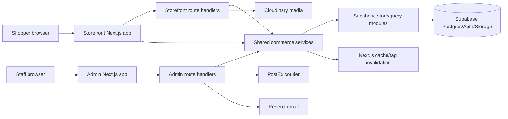

# Architecture Review

## Executive summary

Buy N Try is a two-application Next.js monorepo: a public storefront and a staff-only admin console share commerce rules, React components, and Supabase data access. The architecture is workable and has no import cycles or broken graph references. Its main structural risk is concentration: several large Client Components coordinate UI, validation, network calls, and state in one file, while a few shared modules are imported almost everywhere.

The safest improvement is evolutionary. Preserve the existing request and data contracts, add boundary tests, and extract one responsibility at a time from the largest components. A broad rewrite would create more risk than value.

## Evidence and confidence

- Review commit: `f5fa40b9ddc32052916b2e023d40ebe595ce9e15` plus the Phase 2 working changes.
- Source scan: 1,102 in-scope files.
- Knowledge graph: 2,762 nodes, 5,135 edges, 2,056 resolved import edges, 9 logical layers, and 12 guided-tour steps.
- Graph SHA-256: `92b0b0345ec59a3774faf2ea7dc4f4d0c366fe99a4810135c6f796e5942dd292`.
- Integrity checks: no duplicate node IDs, dangling edges, incomplete nodes, missing scanned files, graph files outside the scan, unassigned file nodes, self-imports, or import cycles.
- Confidence: high for repository structure and static dependencies; medium for runtime behavior not exercised against production. No production data, traffic, secrets, or infrastructure were changed or probed.

The Understand graph had to use its documented deterministic fallback after the account's subagent allowance was exhausted during a full rebuild. The previous verified graph was pruned, every current import edge was recomputed, all 19 changed source files were re-analyzed, and the final graph passed the integrity checks above. This limitation does not affect the measured import topology, but runtime conclusions remain explicitly separate from static evidence.

## System map

### Logical layers

| Layer | File-level nodes | Responsibility |
| --- | ---: | --- |
| Storefront and Admin UI | 329 | App Router pages, layouts, client/server components, and presentation |
| API and request boundary | 87 | Route handlers, middleware, authentication, validation, and external-facing adapters |
| Commerce domain services | 161 | Commerce rules, integrations, reusable helpers, and application services |
| Data and persistence | 169 | Supabase stores, query helpers, SQL migrations, policies, and database maintenance |
| Tests and QA | 160 | Unit, contract, smoke, security, and regression checks |
| Operations and delivery | 66 | CI, audits, backups, deployment helpers, and production verification scripts |
| Configuration and build | 31 | npm, TypeScript, Next.js, Vercel, and tool configuration |
| Documentation and planning | 129 | Architecture, operating, audit, design, and implementation records |
| Agent governance/tooling | 4 | Repository-local automation guidance |

## Main request and data flows

### Public shopping

1. App Router pages and Server Components request catalog, chrome, review, promotion, and settings data.
2. Shared domain and `lib/db/*-store` modules issue bounded Supabase queries.
3. Frequently reused storefront reads use `unstable_cache` and named cache tags.
4. Interactive Client Components call storefront HTTP routes or client-safe adapters; they must not import server Supabase/database modules at runtime.
5. Checkout validates the request, persists the order, and returns a shopper-facing result. Courier processing is handled separately from the browser request boundary.

### Administration

1. Admin middleware protects staff routes and API boundaries.
2. Admin pages and Client Components call admin route handlers through the shared fetch adapter.
3. Handlers validate input, call admin store/domain modules, and invalidate relevant storefront cache tags after writes.
4. Server-only integrations communicate with PostEx, Resend, Cloudinary, and Supabase; credentials remain on server boundaries.

### Operational automation

- GitHub Actions installs from the lockfile and runs tests, both linters, both TypeScript checks, and both production builds.
- Vercel deploys the storefront and admin as separate projects.
- Cron and internal handlers perform storefront warming and courier synchronization.
- Supabase migrations describe the database and policy history. This review read migration files only; it did not run them against production.

## Dependency shape

The graph has no import cycles. Most cross-layer direction is expected: UI to domain (507 imports), API to domain (260), UI to data (119), data to domain (99), and API to data (80). The one domain-to-UI import is `lib/gadget-pdp-lcp.ts` consuming a pure image helper stored under `components/gadget/gadget-image.ts`. That is a placement smell, not a runtime defect.

The most central modules are `lib/types.ts` (155 importers), `lib/utils.ts` (86), the shared button (79), admin observability (63), admin authorization/helpers (63), and the main storefront/admin data facades (49/46). Changes to these modules deserve focused regression tests because their blast radius is wider than an ordinary feature file.

## Failure boundaries

| Boundary | Expected containment | Main risk |
| --- | --- | --- |
| Browser to route handler | Validation and safe error response | Invalid or replayed requests reaching business operations |
| Client to server module graph | Client-safe HTTP/type boundary | Server credentials or Node-only code entering client bundles |
| Domain to Supabase | Store/query modules and database policies | Partial writes, excessive queries, or policy mismatch |
| Admin writes to storefront cache | Explicit tag/path invalidation | Stale shopper content after successful admin changes |
| Application to PostEx/Resend/Cloudinary | Server adapters with bounded errors | Provider latency, duplicate side effects, or transient failure |
| CI to release | Required tests, lint, types, and builds | A green local result diverging from the hosted runtime |

## Findings and recommended sequence

1. Keep public reads read-only. The settings read path called an admin normalization writer; draft PR #3 removes that call. Treat that PR as a prerequisite before release.
2. Enforce the client/server boundary. Phase 2 adds an AST regression test that rejects runtime imports of server Supabase and database-store modules from Client Components while permitting type-only imports.
3. Reduce concentration incrementally. Start with checkout, product editing, settings, broadcast management, and order detail. Extract pure state/reducer logic and request adapters before splitting presentation; preserve request/response contracts and add characterization tests first.
4. Move the pure gadget image calculation to a neutral domain/utility path only when a nearby feature change already touches both importers. A standalone move has low user value.
5. Treat central shared modules as high-blast-radius code. Require targeted tests plus both application builds when changing shared types, utilities, authorization, observability, cache, or data facades.

## What this review does not claim

- Static imports do not prove production latency, query counts, cache hit rates, or provider reliability.
- Passing tests do not remove the remaining development-tool advisories documented in `SECURITY_REVIEW.md`; the production dependency audit is clean on the current stacked branch.
- The absence of import cycles does not prove that every business transaction is atomic or idempotent.
- No production deployment, database query, migration, secret update, billing change, or live destructive test was performed.
